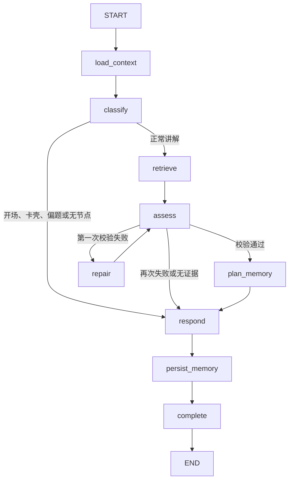

# LangGraph 教学流程本地验收

本次教学图实现范围为需求规格说明书第 3.1 节 U0003/U0004，以及第 3.4 节故障处理和第 5.3 节 SSE 约定。核心入口为 `backend/app/agents/feynman_agent.py`，真实执行 `StateGraph`。原版前端已接通该图并保留现有样式；右窗百科与报告评分沿用基线实现，不将它们标记为新增的模型推理能力。

## 启动

在仓库根目录打开 PowerShell。首次安装依赖：

```powershell
.\backend\.venv\Scripts\python.exe -m pip install -r backend/requirements.txt
```

启动后端，无须 Node.js 或 npm：

```powershell
.\backend\.venv\Scripts\python.exe -m uvicorn app.main:app --app-dir backend --host 127.0.0.1 --port 18080
```

在另一个 PowerShell 中启动交互验收客户端：

```powershell
.\backend\.venv\Scripts\python.exe backend/scripts/accept_langgraph.py
```

默认学生为 `student / 123456`。客户端会读取服务端资料、创建会话、输出角色开场，显示实际首字时间。输入 `/history` 查看落库的对话、评估证据、连续达标次数和真实图节点路径。`/role child`、`/role peer`、`/role examiner` 切换听众，`/lookup 问题` 调用现有右窗，`/exit` 退出。结束客户端不删除学习历史。

指定目标知识点：

```powershell
.\backend\.venv\Scripts\python.exe backend/scripts/accept_langgraph.py --doc 1 --node 4 --persona examiner
```

也可以在 `http://127.0.0.1:18080/docs` 登录取令牌，点击 Authorize，然后调用下列接口。验收环境的 8000 端口受 Windows 限制，因此后端和开发启动器统一默认使用 18080。

| 接口 | 用途 |
| --- | --- |
| `POST /api/v1/sessions` | `{doc_id, persona_type, node_id?}` 创建会话；校验知识点属于该资料 |
| `POST /api/v1/sessions/{id}/opening/stream` | 流式角色开场；重复请求返回已保存的开场，不重复插入 |
| `PATCH /api/v1/sessions/{id}/persona` | `{persona_type}`；保存角色切换分隔消息，保留历史 |
| `POST /api/v1/sessions/{id}/feynman/stream` | `{content}`；运行教学图 |
| `GET /api/v1/sessions/{id}/messages` | 恢复历史，读取助手消息的 `meta_json` |

原版 React 工作台现已完成适配，可在 `http://127.0.0.1:5173/` 验收完整双窗交互，见 [原版工作台本地验收](FRONTEND_LOCAL_ACCEPTANCE.md)。命令行客户端仍保留用于单独检查后端。

## 需求与实现对应

| 需求 | 实现与验收方式 |
| --- | --- |
| U0003 三种听众开场 | 开场接口读取知识点，按角色提出问题；不替学生给出完整答案 |
| U0003 中途切换角色 | PATCH 后历史新增 system 分隔消息，历史上下文和掌握度保留 |
| U0004 SQL＋RAG | 图加载当前知识点、前置依赖、历史薄弱点及双窗历史，再召回当前文档 Top-4 原文 |
| U0004 评估漏洞 | 结构化区分 omission、misconception、jargon；校验知识点归属和原文证据 |
| U0004 连续两轮 | 必须回应当前知识点的深度追问；达标证据、连续次数持久化，不以出现概念名判定掌握 |
| U0004 卡壳/偏题 | 分别鼓励右窗查证或引导回到当前知识点，均不凭空加分 |
| U0005 与左窗关联 | 加载 need_lookup 历史；新查证会打断已有连续达标计数，再次独立复讲后重新累计 |
| 3.4 JSON 畸形 | 一次纠错，仍失败保留追问、跳过数值更新并记录原因 |
| 3.4 模型调用失败 | 最多两次指数退避重试；可见错误，不假装模型评估成功 |
| U0004 记忆更新失败 | SAVEPOINT 回滚记忆变化，保留追问和失败标记，不发送虚假更新 |
| 5.3 流式通信 | token、citation、memory_update、done；最终数据库提交后才发送 memory_update 和 done |
| 失败的流 | 返回明确的 error 事件，不返回 done；先查历史再重试，避免重复提交 |

图节点路径：



评分后先生成记忆变化方案，回复流结束后在短事务中应用并保存消息，避免远程模型等待期间持有 SQLite 写锁。单个会话的教学、开场、角色切换与生成报告按顺序处理；当前部署仍要求单 Uvicorn worker。

## 本地模式与真实模型

默认 `MOCK_LLM=true`：执行同一张真实 LangGraph，但评估和回复使用明确标记的本地规则演示，不消耗 API 费用。此模式不会认证高质量深度回答，也不会将新的未掌握知识点升级为 mastered。

真实模型验收时，将 `backend/.env.example` 复制为 `backend/.env`，填写供应商兼容的 `OPENAI_BASE_URL`、`OPENAI_API_KEY`、`OPENAI_MODEL`，设 `MOCK_LLM=false`，重启后端。未配置密钥时返回配置错误，不悄悄切回规则评分。程序不打印密钥。

文档没有规定加减分公式和高质量数值阈值。本实现细则为：准确度和通俗度均至少 80、无已识别漏洞，且正在回应同一知识点的深度追问，才计为高质量。单轮达标 +15；一般有依据的解释 +8；概念错误 -10；其他漏洞 -3。连续两轮高质量后至少达到 80；未达两轮的新知识点最高 79。所有分数限制在 0–100，明确错误会使已掌握节点降到 80 以下。连续两轮通过时将对应历史薄弱点标为已解决。上述数值是可评审的实现细则，不是文档原文。

## 自动化验收

```powershell
.\backend\.venv\Scripts\python.exe -m pytest backend/tests -q
```

`test_langgraph.py` 使用真实 StateGraph、SQLite 和 FastAPI SSE，覆盖角色开场与重放、归属校验、两轮掌握、角色切换保留上下文、三种薄弱点、查证回流、非法 JSON 与伪造证据、记忆写入失败、最终提交失败、慢模型期间另一数据库写入。另通过本机 HTTP 模型替身验证实际 OpenAI SDK 的 JSON 纠错和流式文本；替身测试不代表真实供应商的教学质量。

开场首字 ≤2 秒、讲解首字 ≤3 秒是需求指标。客户端计时只统计首个 token，引用和状态提示不算首字。真实模型的教学质量与时延需要配置供应商后实测，离线或本机替身测试不能代替该验收。

本次提交范围和前后端验证汇总见 [更新报告](UPDATE_REPORT_2026-11-24.md)。

## 本次验证记录

2026 年 11 月 24 日，Python 3.12.14、LangGraph 1.2.24 环境下，最终完整后端测试 `43 passed`，前端接口测试 7 项通过，TypeScript 与生产构建通过，`pip check` 无依赖冲突，`git diff --check` 通过。

在实际 Uvicorn 服务上用交互客户端执行开场、切角色、卡壳、右窗查证和再次讲解，均得到已保存的 done 事件。离线模式本次开场首字约 0.091 秒、普通讲解首字约 0.145 秒；这些是本机规则演示计时，不代表真实供应商的响应速度。真实 SDK 与 JSON 纠错、流式文本的接入已通过本机 HTTP 模型替身验证，尚未调用付费模型进行教学质量验收。
